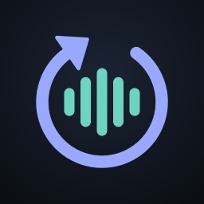
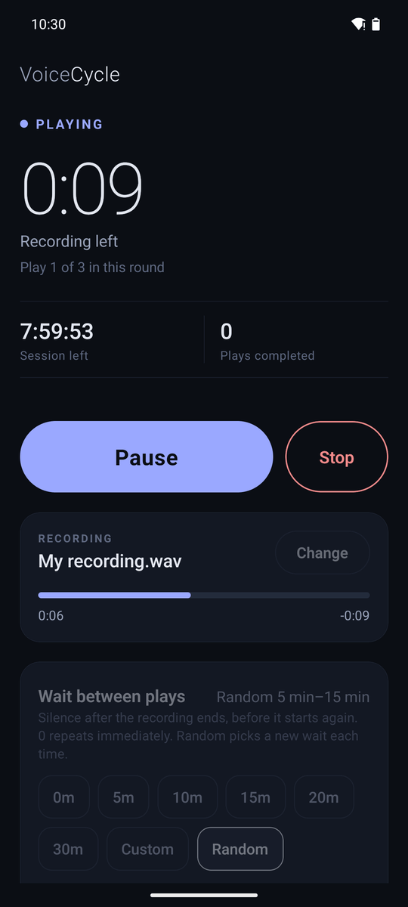
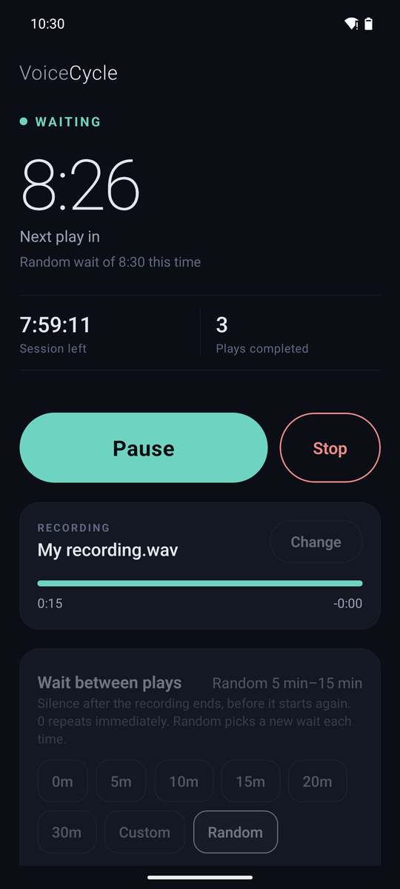
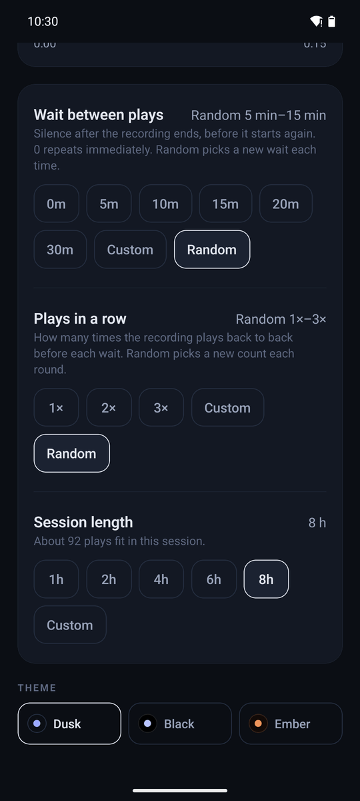
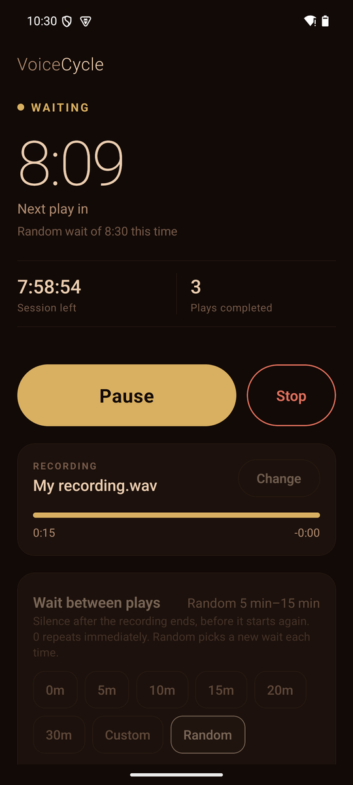
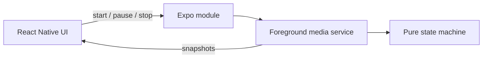

<div align="center">



# VoiceCycle

**Play. Wait. Repeat.**

An offline Android app that plays your own recording, waits, and plays it again, even with the screen locked.

[](#install)
[](https://docs.expo.dev/)
[](#privacy)
[](LICENSE)

[**Download the APK**](../../releases/latest) · [How it works](docs/ARCHITECTURE.md) · [Build from source](docs/BUILDING.md) · [Testing](docs/TESTING.md)

</div>

<p align="center">
  
  
  
  
</p>

## Why VoiceCycle

You have a recording you want to hear again and again: a language lesson, a lecture, a practice drill, a breathing exercise. Music players can loop it, but they can't leave a pause between plays. A JavaScript timer can, until Android suspends the app in the background and the next play never comes.

VoiceCycle runs the whole cycle in a native Android media service. It keeps its own clock, so the next play starts on time after a silent wait, with the screen off and the phone in Doze.

## Features

- **Repeat with a pause.** Your recording plays to the end, then VoiceCycle waits before playing it again from the beginning.
- **Random waits.** Pick a minimum and maximum, for example 5 to 15 minutes. Every wait gets a new random length.
- **Plays in a row.** Play the recording 2 or 3 times back to back before each wait, or let VoiceCycle pick a random count each round.
- **Session timer.** Stop after 1, 2, 4, 6 or 8 hours, or any length up to 24 hours. The last play fades out gently.
- **Works with the screen locked.** Verified with the screen off and Android Doze forced on.
- **Lock-screen controls.** Pause, resume and stop from the notification or lock screen. The notification counts down to the next play.
- **Polite with calls and other apps.** Pauses for a phone call and resumes after it. Pauses when another app starts music or headphones are unplugged.
- **Session report.** When you come back, the app tells you whether the last session finished, and how many times the recording played.
- **Dark themes.** Dusk, Black for OLED screens, and warm Ember.
- **Remembers everything.** Your recording and settings are still there next time.
- **Completely offline.** No account, no ads, no analytics, no network access.

## How a session looks

With a 12-minute recording, a random wait of 5–15 minutes, 1–3 plays in a row, and a 2-hour session:

```
0:00  ▶ play 1 of 2
0:12  ▶ play 2 of 2
0:24  · wait 8:36 (random)
0:33  ▶ play 1 of 1
0:45  · wait 13:02 (random)
0:58  ▶ play 1 of 3
 ...
2:00  ■ session time is up, fade out
```

## Install

1. Download `VoiceCycle-vX.Y.Z.apk` from the [latest release](../../releases/latest) on your Android phone.
2. Open it. If Android asks, allow installs from your browser or file manager.
3. If Play Protect warns about an unknown app, choose **More details**, then **Install anyway**. The APK is not on the Play Store.
4. Open VoiceCycle and allow notifications. They power the lock-screen controls.

Requires Android 7.0 or newer.

## Quick start

1. Tap **Select audio** and pick your recording.
2. Choose **Wait between plays**: a preset, a custom value, or **Random** with a minimum and maximum.
3. Choose **Plays in a row**: how many times it plays back to back before each wait.
4. Choose **Session length**.
5. Tap **Start** and lock your phone.

> **Tip:** start with a short session and check the session report afterwards. If it says the session was cut off, follow the battery settings below.

## Settings

| Setting | Options | Notes |
|---|---|---|
| Wait between plays | 0, 5, 10, 15, 20, 30 min · Custom 0–240 min · Random min–max | Starts when the recording **ends**. Decimals allowed, so `0.5` is 30 seconds. 0 repeats immediately |
| Plays in a row | 1×, 2×, 3× · Custom 1–50 · Random min–max | Random draws a new count for every round |
| Session length | 1, 2, 4, 6, 8 h · Custom 1–1440 min | The app shows roughly how many plays fit |
| Theme | Dusk, Black, Ember | Black suits OLED screens. Ember is a warm palette |

**Pause** freezes everything: the recording, the wait countdown and the session timer. Settings are locked while a session runs and apply to the next one.

## Background playback

VoiceCycle does not ask for a battery-optimisation exemption. A foreground media service is normally enough. Some phone brands still close background apps. If the session report says a session was **cut off**:

1. Open **Settings > Apps > VoiceCycle > Battery** and choose **Unrestricted** (also called "Don't optimise" or "No restrictions").
2. **Samsung:** remove VoiceCycle from *Sleeping apps* and *Deep sleeping apps* under Battery > Background usage limits.
3. **Xiaomi, Oppo, Vivo, Huawei, OnePlus:** also allow *Autostart* and lock the app in Recents. See [dontkillmyapp.com](https://dontkillmyapp.com) for your model.
4. Battery Saver may restrict background work. Charging the phone during long sessions helps.

| Situation | What happens |
|---|---|
| Screen locked, other apps in use | The session keeps running |
| Phone call | Pauses, then resumes after the call |
| Android closes the app, or the phone restarts | The session ends and does not restart on its own. The app tells you next time you open it |

## Supported audio

Anything your phone's built-in Android player can decode, including MP3, M4A/AAC, WAV, FLAC, OGG, Opus and AMR. Most voice-recorder apps produce one of these. WMA, AIFF and ALAC usually don't play on Android, so convert them to MP3 or M4A first. The app checks every file when you select it.

## Privacy

VoiceCycle has no network code, no analytics and no accounts. Your recording is copied into the app's private storage on your phone and never leaves it. The app asks only for notification, foreground service and wake lock permissions. Microphone access is explicitly blocked.

## Build from source

```bash
npm install
npm run android        # development build on a connected phone
npm run build:apk      # release APK (Windows; use ./gradlew assembleRelease in android/ elsewhere)
```

You need Node.js 20+, JDK 17 and the Android SDK. [docs/BUILDING.md](docs/BUILDING.md) covers setup on Windows, signing with your own key, the EAS cloud build and publishing releases.

## Testing

```bash
npm test               # 50 Jest tests
npm run test:native    # 31 JUnit tests for the playback state machine
npm run typecheck
npm run lint
```

CI runs all of them on every push. [docs/TESTING.md](docs/TESTING.md) has the emulator results, a 19-step manual test plan and a checklist for long sessions on real phones.

## How it works



The native service owns playback, the wait and the session timer. The interface only shows what the service reports, so reopening the app can never start a second session. [docs/ARCHITECTURE.md](docs/ARCHITECTURE.md) explains the design, the state machine and why simpler approaches fail in the background.

## Roadmap

- [ ] Field reports from more phone brands
- [ ] Choose several recordings and rotate between them
- [ ] Optional restart of an interrupted session
- [ ] Google Play release

iOS is not supported. The playback engine is Android-only.

## Contributing

Bug reports from real phones help most, especially from long sessions. Please read [CONTRIBUTING.md](CONTRIBUTING.md) and use the issue templates. Changes are listed in [CHANGELOG.md](CHANGELOG.md).

## License

[MIT](LICENSE) © 2026 Saumilya JJ
