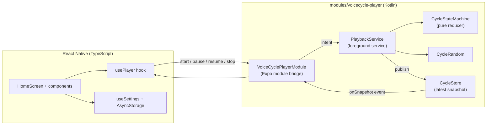
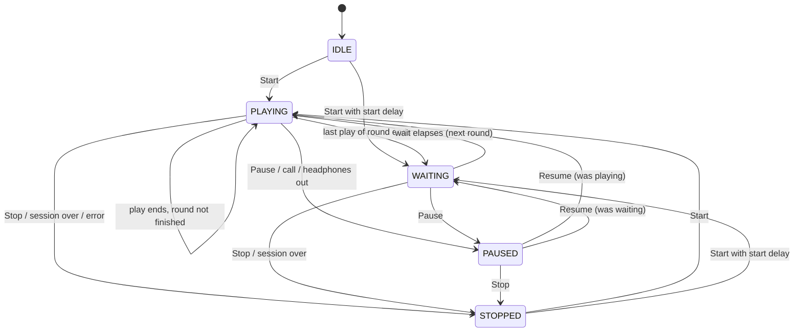

# Architecture

VoiceCycle has one hard requirement: the play, wait, replay cycle must keep going for hours with the screen locked. Everything in the design follows from that.

## Why the cycle runs natively

Android suspends the JavaScript thread of a backgrounded React Native app. A `setTimeout` that should fire after a 10-minute silent wait can fire hours late, or never. During the wait no audio is playing, so nothing else keeps the process awake.

So the whole cycle lives in a native Android **foreground service** of type `mediaPlayback`:

- It owns the `MediaPlayer`, the media session, audio focus and the timers.
- It keeps its own clock with `SystemClock.elapsedRealtime()`.
- It holds a partial wake lock only while a session is playing or waiting, with a timeout so it can never be held forever.
- It stays in the foreground for the whole session, including pauses and silent waits.

Two common shortcuts were rejected:

| Option | Why not |
|---|---|
| `expo-audio` plus a JavaScript timer | The timer is not reliable once the app is in the background |
| Media3 `MediaSessionService` | It leaves the foreground state when playback pauses. Android 12+ then refuses to restart playback from the background after the silent wait |

The service was verified on an Android 15 emulator with the screen off and Doze forced on with `dumpsys deviceidle force-idle`. Every wait ended on time to the second.

## Components



| File | Job |
|---|---|
| `CycleModel.kt` | Immutable session model, config and effect types |
| `CycleStateMachine.kt` | Pure transition function. No Android APIs, fully unit-tested |
| `CycleRandom.kt` | Draws random waits and round sizes, outside the pure reducer |
| `PlaybackService.kt` | Foreground service. Applies effects to `MediaPlayer`, focus, wake lock and timers |
| `PlaybackNotification.kt` | Media notification with Pause/Resume and Stop. Shows a live countdown during the wait |
| `AudioFocusController.kt` | Audio focus with delayed gain, so a play due during a call starts after the call |
| `PlayerSnapshot.kt` | Snapshot sent to JS, plus the persisted report of the last session |
| `VoiceCyclePlayerModule.kt` | Expo module: validates options, forwards commands, streams snapshots |

The service is the **single source of truth**. The UI never runs playback timers of its own. It renders snapshots and sends commands, so reopening the app cannot start a second loop. A Start while a session is active is ignored by the state machine.

While the app is visible, the service ticks every second so the UI can show live progress. While it is hidden, it ticks at most every 30 seconds and lands exactly on the next deadline.

## State machine



Rules:

- An optional **start delay** is a silent WAITING phase before the first play, flagged with `inStartDelay`. The session timer does not run during it and starts when the first play begins. Pause and Stop behave as in any wait.
- A **round** is N back-to-back plays, where N is "Plays in a row". The wait comes after the last play of a round.
- The wait starts when the recording **ends**, never when it starts.
- A wait of 0 starts the next round immediately.
- **Random** waits and round sizes are drawn again for every round. The service draws them with `CycleRandom` and passes them into the reducer with the event, so the reducer stays pure and testable. Every value in the range, both ends included, is possible. Random waits are whole seconds.
- **Pause freezes everything**: the recording position, the start delay, the wait countdown and the session timer. Resuming a pause taken during a wait continues the remaining countdown.
- When the session timer reaches zero during a play, the recording fades out over 3 seconds.
- When a round ends and the session time left is not longer than the next wait, the session ends at once instead of waiting in silence for nothing.
- Stop cancels playback, the pending wait and the session timer.

## Interruptions

| Event | Behaviour |
|---|---|
| Phone call or alarm during a play | Pauses, then resumes by itself when the call ends (Android 8+) |
| Next play due during a call | Waits for the call to end, then plays |
| Another app starts playing music | Pauses and stays paused until you press Resume |
| Headphones unplugged | Pauses |
| Silent wait | Audio focus is released, so other apps may play during the wait |
| App swiped away from Recents | The session keeps running. Stop it from the notification |

## What survives and what does not

| Situation | Result |
|---|---|
| Screen locked, app in background, other apps in use | The session continues. This is the supported case |
| Android kills the app (aggressive battery saver, low memory) | The session ends and is **not** restarted. On the next launch the app says the last session was cut off, and after how many plays |
| Phone restarts | The session ends and is not resumed |
| Recording file missing (app data cleared) | The app asks you to select the recording again |

Automatic recovery after a kill or reboot is deliberately not implemented. Audio starting by itself without user action would be surprising, and the behaviour could not be tested reliably across phone brands.

## Data and privacy

- Picked recordings are copied into the app's private storage, so they stay playable if the original is moved. The previous copy is deleted when you pick a new one.
- Settings live in AsyncStorage on the device.
- The app makes no network calls and has no analytics, accounts or ads.
- Permissions: foreground service (media playback), wake lock and notifications. Microphone access is explicitly blocked.

## Project layout

```
App.tsx                         Root component
src/screens/HomeScreen.tsx      The single screen
src/components/                 Presentational UI pieces
src/hooks/                      usePlayer (native state), useSettings (persistence)
src/domain/                     Pure logic: time, settings validation, display text, reports
src/services/                   AsyncStorage settings, recording import
src/theme/                      Colour themes
modules/voicecycle-player/      Local Expo module with the native Android player
plugins/withReleaseSigning.js   Optional release signing from Gradle properties
docs/                           Architecture, building and testing guides
```

The app has a single screen, so Expo Router is not used. The `android/` folder is generated by `expo prebuild` and is not committed.
